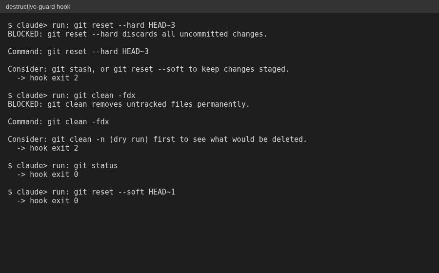

# Claude Code setup

I work in Claude Code with written ground rules, plus guard hooks that stop secrets
from being committed and destructive commands from running.

## What is mine

### Ground rules (CLAUDE.md)

- Verify before claiming a cause. A guess is labeled as a guess.
- Sandbox first. Nothing touches a live account until it passes in a test account.
- A check that cannot fail is not a check.
- Client data never enters a repo. Credentials stay in local, uncommitted env files,
  named so their scope is clear.
- Plan before building: spec, then tasks, then tests.
- A learning system: when the same correction comes up twice, it becomes a written
  rule, and a repeated workflow becomes a skill.

### Guard hooks

Two hooks run before every shell command Claude Code makes:

- **secret-guard** blocks committing env files, keys, and other secret files.
- **destructive-guard** blocks commands that cause damage you cannot undo, such as
  `git reset --hard`, `git clean -fdx`, and recursive deletes on broad paths. Safe
  commands pass through.

*The hook blocks `git reset --hard` and `git clean -fdx` with a safer suggestion, and
lets `git status` and `git reset --soft` through.*

### CloseBot skills

The plan, build, and test skills are covered in
[the CloseBot write-up](../closebot-pipeline/README.md).

## Adapted

- **silent-failure-hunter subagent**: adapted from Anthropic's agent of the same name.
  I rewrote and tuned it to review code for swallowed errors and silent fallbacks.

## Adopted from others (not my work)

These come from Addy Osmani's
[agent-skills](https://github.com/addyosmani/agent-skills), MIT license. I adopted
them as written. Credit goes to the author.

- Skills: planning and task breakdown, spec-driven development, test-driven
  development, debugging and error recovery.
- References: definition of done, testing patterns, security checklist.
