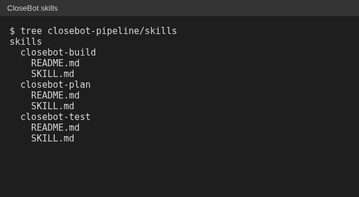
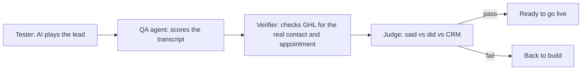

# CloseBot plan, build, test pipeline

I built AI SMS booking bots on CloseBot connected to GHL for a martial arts gym network
across 13 states, 228 trial bookings in 30 days. The bots answered leads from Meta ads,
qualified them, and booked trial classes into GHL calendars.

Every bot went through the same three Claude Code skills I wrote.

## 1. Plan

The plan skill interviewed for each location's details: programs, age groups, schedule,
and rules. The output was a written spec. Nothing was built without an approved spec.

## 2. Build

The build skill generated the bot from the approved spec using one fixed, proven
template. Unused paths were trimmed (for example, no youth program meant no youth
branch). The old version was archived, never overwritten.

## 3. Test

Before any bot went live, it passed a 4-stage test: an AI plays the lead, a QA agent
scores the transcript, a verifier checks GHL for the real appointment, and a judge
compares what the bot said, what it did and what the CRM shows.

The judge stage is what catches a bot that says "you're booked" when no appointment was
made. Tests ran only against a sandbox, and the harness refused to run against a live
source unless that was explicitly allowed.
