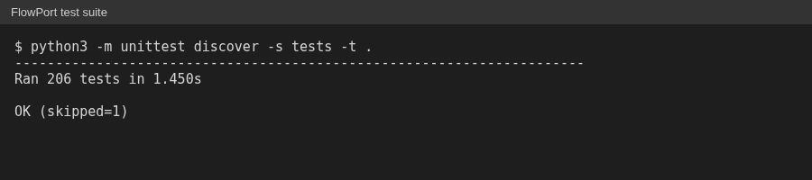

# FlowPort

I built FlowPort, a local tool that copies a GoHighLevel workflow, steps and triggers,
from one sub-account to another. It matches IDs by name, writes only drafts, backs up
before any overwrite, and reads the result back to verify it.

FlowPort has 206 automated tests. The largest live run copied a 70-node workflow
across sub-accounts.

## The problem

GHL has no clean way to copy a single workflow into a different sub-account. Rebuilding
one by hand is slow, and it is easy to point a step at the wrong pipeline, calendar, or
custom field.

## How it works, in concept

1. **Read the source workflow**, including its steps and triggers. It uses the same
   internal endpoints the GHL web app uses, with the operator's own session.
2. **Match references by name.** Pipelines, stages, calendars, users, and custom fields
   have different IDs in every sub-account. FlowPort looks each one up by name in the
   target account.
3. **Stop on any mismatch.** If a name has no match, or more than one, the run is
   blocked. It never guesses.
4. **Write a draft.** The copy lands as a draft with triggers inactive, so nothing goes
   live by accident.
5. **Verify.** It reads the new workflow back and compares it to the source, so "done"
   means checked, not just accepted.

## Safety rules

- Draft only. There is no publish or delete step in the copy path.
- Name clashes stop and ask: rename, replace, or cancel.
- A published target workflow is refused by default.
- Anything that would be overwritten is backed up first. If the backup fails, the write
  does not happen.
- Client workflow data stays local and is never committed.
- Every write is logged, without any credentials.

## Proof

The test suite runs offline, with no network and no account access.

*Test run on a clean copy: 206 tests, OK, 1 skipped (that one needs a private set of
real exports that is not part of the clean copy).*

An adversarial audit found 40 defects, 6 of them blockers. I fixed them and added
tests to cover them.
